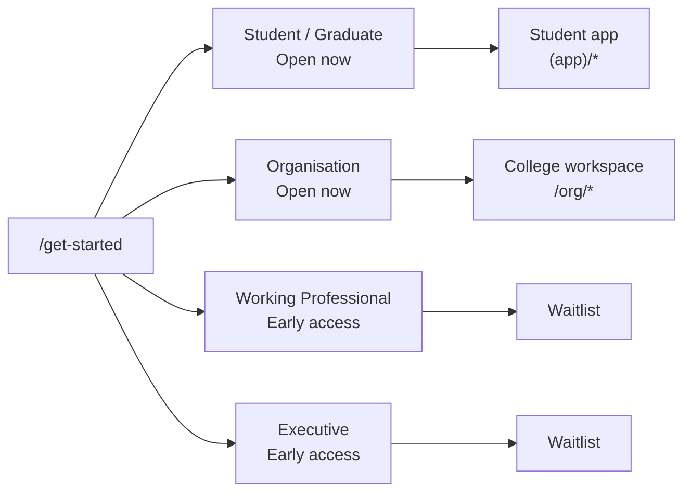
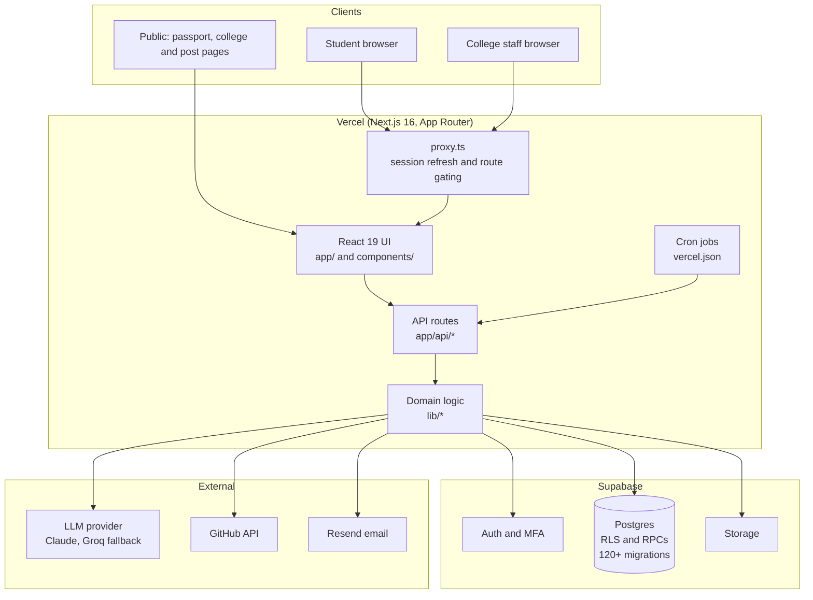
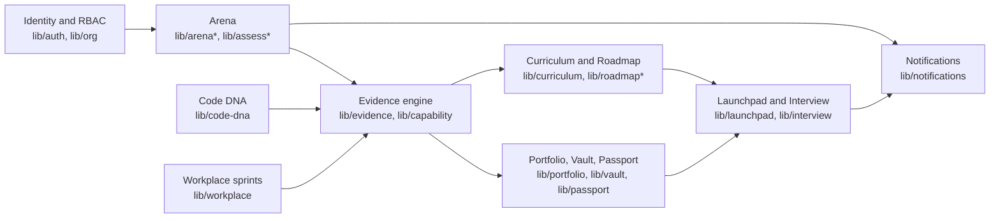
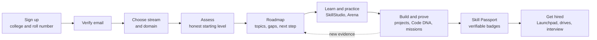
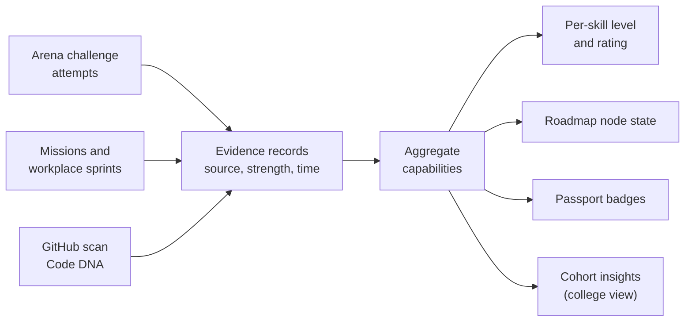
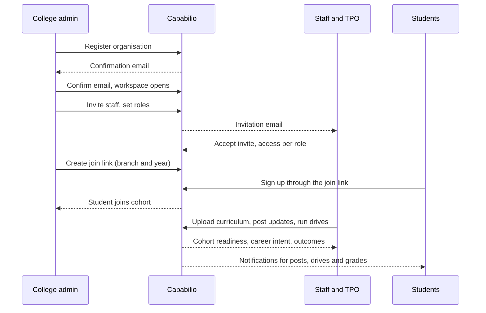
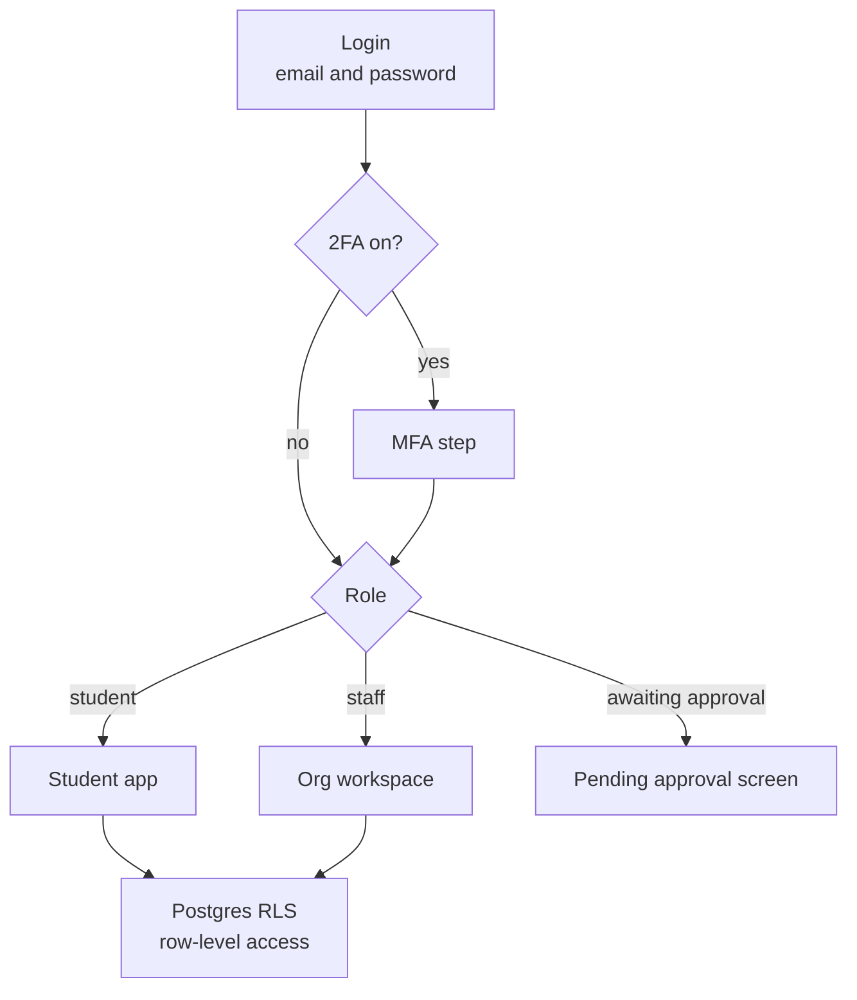
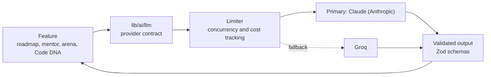
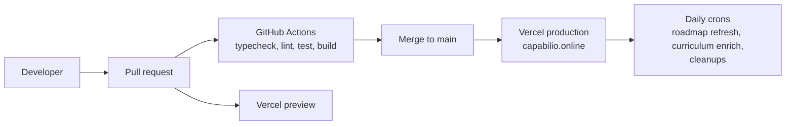

# Capabilio AI

**The career operating system where proof beats resume.**

Capabilio turns what a person has actually *demonstrated* (assessment attempts, projects, real GitHub activity) into a structured, verifiable picture of where they stand and what to do next. The same evidence serves students, colleges and, later, employers.

Live at **[capabilio.online](https://capabilio.online)**

> **Core principle:** show what someone has *demonstrated*, never what they merely *claim*. Skill levels, career direction and curriculum coverage are inferred from evidence over time and confirmed by the person. AI writes the explanations; it never invents the facts.

---

## Contents

1. [What it does](#what-it-does)
2. [The four paths](#the-four-paths)
3. [System architecture](#system-architecture)
4. [Module map](#module-map)
5. [Student journey](#student-journey)
6. [Evidence engine](#evidence-engine)
7. [Organisation (college) workflow](#organisation-college-workflow)
8. [Authentication and access](#authentication-and-access)
9. [AI layer](#ai-layer)
10. [Notifications and email](#notifications-and-email)
11. [Deployment and CI](#deployment-and-ci)
12. [Tech stack](#tech-stack)
13. [Getting started](#getting-started)
14. [Project structure](#project-structure)
15. [Further reading](#further-reading)

---

## What it does

| Area | What the user gets |
|---|---|
| **Assessment** | A two-layer assessment that places a student at an honest starting level. "Not assessed" is a real state, never a fake zero. |
| **Roadmap** | An AI-generated career tree per target role. Each topic shows the student's measured state, prerequisites and the next step. It refreshes on a schedule and shows what changed. |
| **Arena** | Timed challenges and missions by domain and stream. Results update a per-skill rating (ELO) and feed the roadmap. |
| **SkillStudio** | Structured learning, linked to the roadmap's gaps. |
| **Vault and Code DNA** | A store for certificates, projects and links. Code DNA scans public GitHub repos (ownership verified by a bio code, no OAuth) into an engineering fingerprint built only from scanned facts. |
| **Skill Passport** | A shareable, verifiable profile with a QR code. Badges are issued only from demonstrated work. |
| **Launchpad** | Roles and placement drives matched to the profile. |
| **Interview and Mentor** | Interview practice and an AI mentor that knows the student's real direction and gaps. |
| **Pulse** | A social feed with follows, likes and comments. |
| **Workplace** | Company-style sprints (code, DevOps, frontend, investigation) that earn evidence. |
| **Plans** | Free, Pro and Elite tiers. |
| **Organisation workspace** | A college workspace for staff: members, curriculum, projects, placements, chat, insights and outcomes. |

---

## The four paths

One account per person. A person has one or more *contexts* (path, organisation, role, branch, stream, years), never separate accounts per path.



---

## System architecture

Capabilio is a **single Next.js monolith** on one Postgres database. Modules are separated in code, not as services.



**Request path in one line:** browser → `proxy.ts` (session and gating) → page or API route → `lib/` domain logic → Supabase (RLS enforced) and, where needed, the LLM, GitHub or email.

---

## Module map



Evidence flows **left to right**. Everything a student sees (roadmap, passport, launchpad matches) is derived from the evidence engine, so it cannot drift from what was actually demonstrated.

---

## Student journey



The loop on the right is the point: every attempt or project adds evidence, which updates the roadmap's next step.

---

## Evidence engine

All proof is stored as uniform evidence records, then rolled up into **demonstrated capabilities** by deterministic code (no LLM in the loop).



- Awarding and grading are server-side and idempotent.
- A level reads "Not assessed" when nothing is measured.
- Badges come only from demonstrated work.

---

## Organisation (college) workflow



Staff access is governed by a normalised RBAC model (`roles`, `role_permissions`). Self-access is always implicit. The permission model only gates access to *other* people's data.

---

## Authentication and access



- Sessions are refreshed in `proxy.ts`. Sensitive settings require a verified user.
- Row Level Security and server-side checks enforce access, never the client.
- Roll-number checks and a DB-backed atomic rate limiter protect sign-up and scan endpoints.

---

## AI layer



- One provider contract (`lib/ai/llm`) hides which model answers. The provider is chosen by `LLM_PROVIDER` and `LLM_MODEL`, with `LLM_FALLBACK_PROVIDER` and `LLM_FALLBACK_MODEL` as the backup. Anthropic, Groq and Amazon Bedrock adapters are included.
- Career assessment questions are written by the model into a shared bank per role (target 1000 questions). Until a role is full, assessments keep growing its bank; once it is full the model is no longer called for that role.
- AI writes narrative and generates content. Grading is deterministic.
- Generation is asynchronous and polled, so slow models never block a page.

---

## Notifications and email

- **Stored notifications** (migration `118`) with a bell and unread badge in both the student app and the staff workspace.
- Events from membership, grading, placements, posts, projects, materials and Pulse write notifications to the right audience.
- **Email** goes out through Resend (staff invitations and account emails) and degrades gracefully when no key is set.

---

## Deployment and CI



- Hosting: **Vercel** (region `syd1`). Database and auth: **Supabase**.
- Cron jobs in `vercel.json`: roadmap refresh, curriculum enrichment, roll-number cleanup and stories cleanup, all protected by `CRON_SECRET`.
- Schema changes are numbered SQL files in `supabase/migrations/`, the source of truth for the database.

---

## Tech stack

- [Next.js](https://nextjs.org) 16 (App Router), React 19, TypeScript (strict)
- Tailwind CSS v4, Framer Motion, Recharts, `@xyflow/react` (roadmap canvas)
- [Supabase](https://supabase.com): Postgres, Auth, Row Level Security, Storage
- LLM via a provider abstraction (Claude by default, Groq fallback; Bedrock supported)
- Zod for schema validation
- Resend for email
- Vitest for tests, ESLint, GitHub Actions for CI

---

## Getting started

```bash
npm install
```

Create `.env.local` with:

```bash
# Supabase
NEXT_PUBLIC_SUPABASE_URL=
NEXT_PUBLIC_SUPABASE_PUBLISHABLE_KEY=
SUPABASE_SERVICE_ROLE_KEY=

# AI
ANTHROPIC_API_KEY=   # when LLM_PROVIDER=anthropic
GROQ_API_KEY=        # fallback provider
LLM_PROVIDER=        # e.g. anthropic or groq
LLM_MODEL=
LLM_FALLBACK_PROVIDER=
LLM_FALLBACK_MODEL=

# Email (optional; emails are skipped when unset)
RESEND_API_KEY=
EMAIL_FROM=

# Cron and integrations
CRON_SECRET=
GITHUB_TOKEN=        # optional, raises GitHub API limits for Code DNA
```

Run it:

```bash
npm run dev          # http://localhost:3000
```

Scripts:

```bash
npm run typecheck    # tsc --noEmit
npm run lint         # eslint .
npm test             # vitest run
npm run test:live    # tests against a real database (needs .env.local)
npm run build        # next build
```

---

## Project structure

```
app/            Routes and API handlers
  (app)/        Student app (dashboard, arena, launchpad, pulse, skillstudio, ...)
  org/          College workspace
  api/          API routes (arena, roadmap, org, notifications, cron, ...)
  o/ p/         Public college and post pages
components/     UI, grouped by feature
lib/            Domain logic (evidence, arena, roadmap, org, ai, passport, ...)
supabase/       Numbered SQL migrations
docs/           Architecture, audits and progress notes
scripts/        Content import and seeding scripts
proxy.ts        Session refresh and route gating
vercel.json     Region and cron schedule
```

---

## Further reading

- [`docs/CAPABILIO_PRODUCT_ARCHITECTURE.md`](docs/CAPABILIO_PRODUCT_ARCHITECTURE.md): product and architecture reference
- [`docs/architecture/`](docs/architecture): domain model, journey engine, capability graph, API surface, security
- [`docs/arena-system-design.md`](docs/arena-system-design.md): the Arena design
- [`PRODUCT.md`](PRODUCT.md) and [`DESIGN.md`](DESIGN.md): product intent and design system
